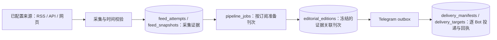

# NewsPaw：证据、简报与投递

NewsPaw 是独立运行在 Mac 上的 Telegram 新闻服务。用户提供的 `news-evidence-cache.py` 与 `news-briefs.md` 是设计参考：借鉴来源归因、时间校验、失败披露和摘录边界；不运行它们，也不依赖或修改原有 OpenClaw 的目录、账号、模型、Cron 或其他工作流。

本文描述后台原型模块；完整产品以 [系统设计](system-design.md) 为准。后台只有一个进程入口 `newspaw control`，由 Mac App 的登录项启动；配置、凭据引用、证据、任务与投递都保存在同一个本机 SQLite 数据库。早期基于 `.env` 的单 Bot 原型（`bot.py`、`config.py`、`service.py` 等）及其 `settings / deliveries / deliveries_v2 / collections / briefs` 表已删除（见 [R13 清理](designs/specs/R13-cleanup.md)）；v0.5.0 及更早的数据库升级后保留这些旧表但不再读写，只有显式的旧偏好导入仍会读取 `settings`。

## 记录之间的关系

- **采集证据**：记录尝试过哪些来源、采集方法、时间、HTTP 状态、失败类型、时间过滤等剔除原因，以及实际接受的标题、来源、摘录和链接。失败或零结果也有记录。采集本身不表示刊次已生成，更不表示已发送。RSS/Atom 的解析与时间校验集中在 `newsparse.py`（纯解析，不做网络请求）。
- **刊次（edition）**：冻结本次选择的证据与模型输出，并记录所用证据。模型处理的只是给定标题与摘录；不能把刊次描述为全文阅读、事实核查或独立验证的结果。
- **投递**：每个获授权的 Bot 有独立的投递记录与回执。网络中断与本地写入之间仍可能存在确认不明（`outcome_unknown`）的窗口，不自动重放，不承诺严格的“恰好一次”。

SQLite 中的这些记录是可追溯的采集与投递日志，不是原始网页归档，也不是防篡改证据库。清理操作只删除超过保留期且不再被任务、刊次或缓存引用的证据。

## 时间与来源是否可用

`published_at` 表示来源提供的**原始发布时间**；`updated` 表示更新；`fetched_at` 表示本次取得数据的时间。三者不可互换。当前新鲜新闻入口要求可解析、带时区的原始发布时间，并拒绝未知时间、仅有更新时间、未来时间和窗口外的条目；保留原始发布时间字符串，不能用抓取时间补齐它。当前默认时间窗口为 24 小时，可配置。

网络错误、格式错误和访问失败属于**采集失败**。HTTP 成功但所有条目过旧，属于**取得数据但没有窗口内结果**；不能说该源“今天没有新闻”。有效 RSS 也可能没有条目或没有主题匹配项。各类情况在采集报告中分别计数；条目不足时少发，不补造、不强凑数量。

来源地址存在不等于来源持续可用。本轮 2026-11-07 本机探测中，NHK RSS 虽返回 HTTP 200，最新条目却停留在 2026-08-08；这只能证明取得了旧内容，不能证明它能提供当天日本新闻。

## 检索、归因与分歧

固定 RSS 是向配置的媒体订阅地址取证；不能把它写成已直接读取媒体全文。保留采集方式、来源地址、条目来源和返回链接；来源字段本身仍是待审阅的来源元数据。旧原型以 Google News RSS 发现无映射主题的入口已随 `.env` 栈删除。

摘要引用的数字编号只对应本次选中条目。RSS 清理后的摘录最多保留 1500 字符，模型每条最多接收 1200 字符，来源卡片最多展示 450 字符；截取内容不代表全文。模型可以指出摘录中明确存在的相互矛盾说法，并分别归因；冲突必须引用至少两个不同且有效的来源编号。不为凑“多角度”创造分歧，也不自动消解分歧。未进行的交叉验证不能表述为已经完成。来源相互转载也不自动构成独立验证。

当前没有独立的行情源。新闻摘录不能支持“当前股价”或实时报价；缺少行情源 URL、报价时间/时区及交易状态时，省略实时价格数字。明确标明历史时间且能归因的历史报价，才可按历史报道概括。

## 多模态与本机数据

文字请求可转换为搜索词；图片用于读取可见主题或文字，不能据此确认新闻事件或人物身份；语音先在本机转码，再交给模型转写。首版限制图片 10 MB、音频不超过 3 分钟，Telegram 下载另设大小上限。新闻配图来自 RSS 的可用图片地址，没有配图时使用文字卡片。播报使用 Mac 的 `say` 与 ffmpeg 生成 MP3，不需要云端 TTS（0.6.3 起，填入 ElevenLabs Key 后 `/listen` 改由 ElevenLabs 朗读，见 `docs/designs/specs/R18-elevenlabs-speech.md`），长播报最多取前 3000 字符；普通 X 简报中的已核验帖子可以由用户主动检查视频，默认关闭。该功能单独计费，只采样短视频的最多两张画面及有限音频，无法处理时会显示覆盖缺口。

Telegram 仅接受已配对主人的私聊。凭据存放在 macOS Keychain，配置中只保存引用；SQLite 与数据目录使用本机私有权限。模型启用后，选定摘录、用户图片或转写音频会发送到配置的模型服务；云端处理不等于纯本地运行。临时音频处理文件在完成或失败后清理，审计记录不保存二进制媒体或 API 请求头。审计中的新闻内容和检索上下文仍可能包含私人兴趣，数据库不会自动同步到公开仓库。

RSS、图片文字、语音转写及参考文件均按不可信内容处理。模型没有 shell、文件写入或任意工具调用权；来源里的指令不赋予执行权限。摘要限制长度并校验来源编号，但这些约束不保证模型语义绝对正确，原始链接和摘录仍需可检查。

## 模型路由：设计与适配器

最新目标路由见 [主备模型与语言设置](model-routing.md)：普通内容使用 **GPT-6 Luna 主用、MiMo Flash 备用**；AV 产业与独立的 X 成人博主订阅使用 **DeepSeek Flash 主用、Grok 4.3 备用**。每个主备槽位独立配置 URL、Key 和模型，分类可继承或覆盖。底层采集、时间过滤、证据存储仍由 NewsPaw 负责。不同服务复用客户端协议不代表把请求发往同一个提供商。

模型调用经 `providers.py`（各提供商协议与按版本绑定的能力探测）和 `model_runner.py`（本机持久执行器，主备切换只在同组内进行，付费结果不确定时不自动重放）执行；分类、主备槽位和 Key 引用来自设置界面写入的配置。旧原型中的 `AIService`、`AVModelService` 与 `GrokService` 适配器已删除。模型名称可配置，自动测试使用模拟响应，不代表真实账号已有访问权限。

AV 产业内容仅整理发行日期、制作公司、行业活动、非露骨采访和企业动态；不转发露骨营销标题、性行为细节或原始配图，不猜测人物年龄。没有可用产业事实的条目明确注明信息不足。原始来源元数据仍是不可信输入。成人组主备均失败时保留任务，不跨成人/普通组回退，也不以未经整理的原始摘录替代结果。

X 账号资讯的获取、账号允许列表、原帖/转发/引用关系、事件聚类尚未实现。后续需要保留帖子 ID、作者、发布时间和原始链接，并记录漏取或限流；不能把“未取得数据”写成“账号没有发布”。若普通新闻仍要求 OpenAI 驱动，可由 OpenAI 提出有界工具调用，Python 通过独立 X 数据接口执行；另用 xAI 的搜索工具属于额外提供商路由，需要在设计中明确。

X 内容分区（普通账号/成人博主）与关注级别（特别/普通）是两个独立维度。每个分区分别汇总，特别关注账号仍可各自日更。成人账号在采集前确定路由，不先交给普通模型分类；其正文、媒体、会话上下文、摘要缓存和投递范围与普通流程隔离。默认采用非露骨的文字动态摘要，媒体自动预览关闭。主用故障可按策略切换成人备用；主备均失败时保留任务，不自动进入普通组，也不直接转发原始成人媒体。普通与成人分区共享 X 总读取预算，各自的子预算不能突破总额。

这些 X 分类、专用摘要、调度与预算约束目前均为设计要求，不代表已有 AV 产业适配器已经覆盖成人博主的实际处理或投递。

新增的语言目标为 `ui_locale` 与 `news_output_locale` 独立设置，各支持 `zh-Hans`、`en`、`ja`。原始证据语言保持不变，所有最终简报按输出语言翻译整理，成人内容的翻译不进入普通组。当前原型的界面、错误文案和来源卡片尚未完全国际化，也未保证所有最终卡片都已翻译，不能把模型的 language 参数等同于该能力已经完成。

## 已实现与后续范围

已有模块：RSS/API/网页来源采集与时间过滤、来源证据记录、证据关联刊次、多 Bot outbox 与逐 Bot 回执、Telegram 私聊命令、持久调度、模型执行器、本机控制接口与 Mac 登录项打包。模块存在不等于产品验收完成，验收状态以 [开发路线图](planning/README.md) 为准。

尚未实现：完整普通/成人主备执行器、MiMo 协议适配、独立的界面/新闻输出三语支持、抓取文章网页补足全文、独立事实交叉验证、同一事件聚类、多来源转载关系判断、按主题持久保存且相互独立的每日刊次、行情专用数据源。不能声称已具备参考规范中的“世界新闻与日本新闻独立刊次”。

新成人产业适配器独立于原有 OpenClaw 工作流；没有连接或修改既有成人内容服务，也没有启用成人图片或视频处理。
