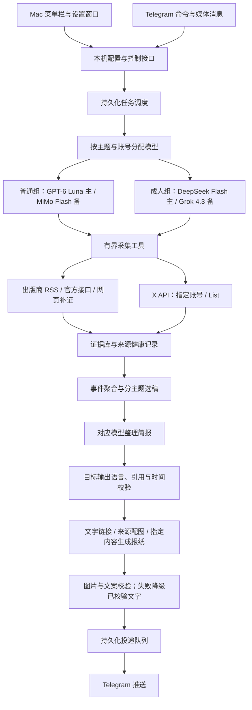

# NewsPaw 系统设计

状态：设计方案与后台原型；原生 Mac 界面、X 接入及完整多管线路由尚未交付。没有安装后台服务，没有配置真实密钥，也没有发送真实 Telegram 消息。

## 1. 产品定位

NewsPaw 是运行在个人 Mac 上的新闻管家：用一个简单的菜单栏应用配置订阅，通过 Telegram 收到分主题简报，也能主动发文字、图片或语音请求新闻。用户无需维护脚本、编辑提示词或进入终端。

已确认的需求：

- 世界新闻、日本新闻、澳洲新闻、数码电子、日本 AV 产业新闻，以及关注的 X 账号动态。
- **每类简报各自设置固定时间**，不使用一个全局早晚时间替代全部分类。
- 普通模型组：**OpenAI GPT-6 Luna（`gpt-6-luna`）主用、MiMo Flash 备用**，驱动普通新闻和普通 X 的检索工具与内容整理。
- 成人模型组：**DeepSeek Flash 主用、Grok 4.3 备用**，不向普通模型组跨组回退。
- 每组的主、备均独立配置 **API URL、API Key、模型 ID**；每个新闻分类可以继承默认组或单独覆盖本组的主备参数。
- X 的**内容分类**分成“普通账号”和“成人博主”两栏，成人博主使用成人模型组，不进入普通模型组。
- X 的**关注级别**另分“特别关注”和“普通关注”：两栏都支持特别关注账号每日单独总结、普通关注账号定时合并整理。内容分类与关注级别是两个独立设置。
- 用户已有 X API，希望节约使用。`@elonmusk` 是特别关注账号的示例，尚未实际添加或访问。
- **App 显示语言与默认新闻输出语言独立配置**，各支持简体中文、English、日本語；默认均为简体中文。
- 所有分类、X 汇总和单账号日更最终翻译整理到新闻输出语言，保留原始证据。界面语言不决定采集语言或新闻输出语言。
- 推送默认**文字与链接**，部分新闻可附来源配图；特别指定的内容先由 AI 总结，再通过生图功能制作 **1–2 张图文报纸**，同时附上可点击来源。生图模型独立配置主备。
- 支持**多个 Telegram Bot**，逐个验证与主人绑定；每个分类可选择一个或多个目标 Bot，特别关注账号可继承或单独覆盖目标。
- 东京时区为设计默认；具体推送时间待用户在界面设置，切换语言不改变时区和时间。

## 2. 最小合适架构

采用 **SwiftUI 原生菜单栏应用 + Python 后台工作进程 + SQLite + Telegram Bot**。先保持单机、单用户、单数据库，不引入微服务集群或向量数据库。

模型决定怎样使用已授权的采集工具，并基于返回证据整理内容；程序执行请求、限制预算、校验结果。模型无权改变订阅、接收人、推送计划或读取本机任意文件。

模型主备配置、接口兼容性、失败切换与能力检查详见 [模型路由与主备配置](model-routing.md)。主备切换复用同一份证据，记录实际模型及切换原因；普通与成人的上下文始终隔离。

RSS 是一种高效证据入口，不是系统的全部能力。网页补证可以补充完整语境或冲突来源；任何补充都必须留下实际 URL、采集方式和时间信息。没有发生网页检索时，不能声称“搜索了网页”。

## 3. 六类信息的处理方式

| 类别 | 采集与选稿重点 | 模型 | 简报安排 |
| --- | --- | --- | --- |
| 世界新闻 | 国际媒体、官方机构；重要进展、影响与不同立场 | 普通主备组 | 独立每日时间，可配置多时段 |
| 日本新闻 | 日本媒体与官方来源；保留本地语境，翻译到输出语言 | 普通主备组 | 独立每日时间 |
| 澳洲新闻 | 澳洲媒体、政府与机构；明确地区、政策生效时间 | 普通主备组 | 独立每日时间 |
| 数码电子 | 厂商发布、可信科技报道与评测；区分发布、传闻、评测、促销 | 普通主备组 | 独立每日时间 |
| 日本 AV 产业新闻 | 独立源配置；发行、厂牌、活动、访谈等非露骨行业信息 | 成人主备组 | 独立开关与每日时间 |
| X 动态 | 用户指定账号或 List；分普通账号与成人博主两栏 | 普通账号用普通组；成人博主用成人组 | 两栏各自汇总；每栏的特别关注账号各自日更 |

**X 成人博主动态与日本 AV 产业新闻是两个独立订阅。** 两者默认继承成人主备组，但分别配置来源、简报时间、选稿规则与投递回执，也可以分别覆盖主备参数；不把博主的日常动态自动混入 AV 产业简报。

来源与主题分开建模：一个日本事件可以同时属于“世界”和“日本”；同一证据只保存一份，但每个主题独立选稿、独立记录已推送版本，不能因为世界简报发过就从日本简报里永久消失。

源列表可在界面增删，不把某家媒体写死为永久可靠。原型保留了参考中出版商的可配置入口，但已独立检查接口：MacRumors 使用实际重定向后的地址；一次 NHK 旧 RSS 探测返回 HTTP 200，但最新条目为 2026-08-08，因此不能当作 2026-11-07 的有效新新闻。界面应显示“内容过期”，而不只显示“连接成功”。这只是该次探测结果，不代表 NHK 的全部服务状态。

## 4. X：按账号总结，并控制采集费用

### 两个内容分区，各自支持两种订阅

X 页面先选择“普通账号 / 成人博主”，再为账号设置“特别关注 / 普通关注”。例如 `@elonmusk` 属于普通账号分区中的特别关注；成人博主栏等待用户提供名单，不预填任何真实成人账号。

普通账号使用普通主备组，成人博主使用成人主备组。内容分类在首次采集前由账号或 List 配置确定，不先把原帖发给普通模型再判断是否成人内容。尚未分类的导入项等待确认后才进入模型处理。混合内容账号如被标为成人博主，其整条账号流遵循成人分区路由。

**特别关注**：每个账号独立简报。例如 `@elonmusk` 的当天原帖、引用帖与已选择纳入的回复，整理成主题变化、重要声明和可追溯的原帖列表。可以选择重点 Tesla、SpaceX、xAI 等，也可以总结全部可见内容。不把玩笑、个人观点或愿景直接改写成已经发生的事实。

**普通关注**：多个账号合并为所属分区的 X 简报；普通账号与成人博主不会合成同一份正文。普通账号按事件归组；成人博主侧重非露骨的动态、活动与发布信息。同一事件有后续进展时提示新增信息，单纯重复转发不重复推送。

每个账号配置：

- 稳定用户 ID、当前用户名、普通/成人内容分区、所属主题、特别/普通关注。
- 是否纳入原帖、引用帖、回复、转发；这些开关同时显示在简报覆盖说明中。
- 特别关注账号的独立日更时间；普通关注账号继承所属分区的汇总时间。另设每日新帖读取上限、原文语言提示和关注关键词；最终输出仍遵循全局新闻输出语言。
- 成人分区默认关闭媒体自动预览，单独设置推送开关；提示与简报不自动附带原始成人图片或视频。

账号分区更新通过稳定用户 ID 生效。普通转成人时，尚未执行的任务和待发送简报必须重新路由，旧的普通模型摘要缓存不再参与新一期生成；已经发送的消息保留历史归属，不声称可以撤回已经发给模型的数据。缓存键包含内容分区、模型、提示词版本与内容哈希。

### 省钱策略

1. **首版围绕简报时间增量采集。** 特别关注账号默认在其日更前采集，普通账号在汇总前批量调度；不默认每分钟轮询，也不默认实时提醒。
2. **按稳定账号 ID 保存增量游标。** 已入库的帖子不重复请求全文、不重复交给模型。首次订阅只回补有限时间窗口，不扫历史归档。
3. **一份采集，多处使用。** 马斯克帖子同时涉及数码新闻和 X 日更时，复用证据；需要不同编辑角度时才新增摘要。复用仅在允许的内容分区内进行，不把成人原文、媒体或摘要带入普通模型的上下文。
4. **区分 API 成本与模型成本。** 原始 ID 去重、时间过滤、转载识别先在本机完成；模型只处理新内容，优先文本，按需处理媒体。不要把“少几个 HTTP 请求”等同于“一定少付费用”。
5. **设置总预算、分区预算和账号预算。** 普通账号与成人博主共用一个 X 总预算，各自有子预算，添加成人分区不自动把总上限翻倍。X 平台消费上限、本机每日新帖资源读取上限、每次最大分页数、模型调用与输出上限分别控制。界面区分实际 usage 与本机估算，不显示虚构精确账单。
6. **限额不会伪装成无新闻。** 到预算或限流后显示“预算暂停”“采集不完整”和缺失时间范围；已采到的部分可以标注覆盖范围后生成简报。

账号 timeline 支持 `since_id` 和分页。必须先持久化已拿到的数据，再推进游标；分页未完成时保留回补状态，不能把最高帖子 ID 当作所有较早帖子都已采完。List 的官方参数没有 `since_id`，因此 List 使用分页与本地 ID 去重，另设读量限制。用户名变更不应导致重复订阅。

如果全天采集成功且没有新帖，可以发“本日无新增”，也可在设置中关闭空简报。若采集失败，不能用这句话代替错误状态。

## 5. 证据、事件和简报

### 证据记录

每条保存：来源 ID、原始 URL / 帖子 ID、作者或出版商、来源类型、原始时间文本、发布时间、更新时间（若有）、抓取时间、标题、有限摘录、截断标志、内容哈希、采集方法、抓取结果、主题与模型路由。

- 发布时间、更新时间、事件发生时间、抓取时间为不同字段。
- 不把 `updated` 自动当作 `published`，不把当前时间填入缺失时间。
- “过去 24 小时新闻”只收明确有时区且落入窗口的发布时间。时间未知的候选进入待补证区，不加入新鲜新闻。
- 较旧证据可以作为背景，必须标注它的时间；没有新事实时不能靠重新抓取变成新消息。
- 抓取成功但条目过期、过滤后为空、网络失败、被限流、预算耗尽分别记录。

### 事件层

先用 URL、帖子 ID、内容哈希去掉真正重复，再由模型辅助识别“同一事件的多篇报道”。聚类考虑主体、地点、事件时间、动作和关联链接；不只看标题相似度。

事件保留全部支持材料与不同说法。多个转载同一个爆料不是多个独立佐证；X 个人声明、官方公告和媒体核实分别标明，不能用转发量替代真实性。

事件可分“新事件”“实质更新”“仅重复”“待核实”“存在分歧”。用户默认收到新事件和实质更新；传言是否纳入由分类设置决定。普通固定简报按主题保留重要事件，跨主题可以引用同一个事件而不重复保存数据。

### 简报输出

每条包括：发生了什么、为什么值得关注、目前已知与不确定之处、来源链接、发布时间。需要时展示相互冲突的说法。条数是上限而不是配额，不够就少报。

X 特别关注简报按主题总结账号当天的内容，并保留对应帖子；标题使用“某账号表示/发布/转发”，不把个人发帖当作独立验证结论。

股票或商品实时报价需要独立、带时间与市场状态的价格数据源；没有就不编数值。新闻摘录不是实时行情服务。

## 6. Mac 驻守程序

### 菜单栏

显示运行中、暂停、等待设置、断网或需要关注。点击可打开设置、查看最近任务、立即预览某类简报、暂停推送。关闭配置窗口不停止后台；“退出界面”和“停止 NewsPaw”是明确分开的操作。

### 设置窗口

保持五个主要页面：

1. **订阅与来源**：六类主题开关、关注重点、来源列表、每次条数上限、来源健康。
2. **X 账号**：普通账号/成人博主两栏；添加账号/List、特别或普通关注、帖子类型、独立总结时间、分区读取预算与覆盖状态。
3. **模型与连接**：普通/成人两套配置，每套主备并列，分别编辑 API URL、API Key 与模型 ID；分类可继承或覆盖。显示未配置、验证通过、主用故障、备用接管等状态。验证失败时显示具体连接类型，不暴露密钥。
4. **推送与运行**：顶部为多 Bot 管理，分别填写 Token、验证机器人、绑定主人私聊与测试；分类和特别账号分配一个或多个目标 Bot。另设每个分类独立时间、时区、暂停、补发窗口、文字链接/来源配图/AI 报纸、音频、登录后启动、预算与最近错误。报纸仅对指定内容开启，页数自动或固定 1–2 张，分类和账号可分别覆盖样式。
5. **语言**：App 显示语言、默认新闻输出语言分别选择简体中文、English 或日本語；提供示例预览，两项切换互不影响。

首次引导：添加 Telegram Bot 并分别配对主人 → 配置模型/X API → 选择主题与账号 → 为各分类和特别账号分配目标 Bot、设置时间 → 预览一份简报 → 启动驻守。设置尚不完整的管线保持未启用，不因已勾选主题就持续发送失败提醒。

### 两种语言设置的行为

- `ui_locale` 控制菜单栏、设置、按钮、错误提示与本机状态文字；切换后即时生效，不修改主题、账号、密钥、时区或计划。
- `news_output_locale` 控制所有最终新闻标题、摘要、分歧说明、Telegram 简报说明及播报语言；支持 `zh-Hans`、`en`、`ja`，不提供暗中的分类语言覆盖。
- 采集不因界面语言改变：日文媒体与 X 原帖保留原文、原始时间和 URL，模型在整理阶段翻译成目标语言。专名、账号、产品编号、数字和链接保留准确形式，原始标题可作为可展开的证据。
- 成人来源的翻译也由成人主备组完成，不能为了翻译把正文交给普通模型组。
- 缓存与简报版本包含输出语言。改变输出语言后，未来和待生成的简报使用新语言；尚未发送的旧语言正文在自动投递前必须按当前输出语言重新生成。旧版本仅供历史查看，不因标注旧版本而继续自动发送，也不自动重发已经送达的历史消息。
- 翻译失败时保留证据并按主备策略重试；不把未经翻译的原文冒充目标语言简报发送。语音播报使用匹配目标语言的声音，找不到合适声音时保留目标语言文字并显示音频不可用。
- 例如：`ui_locale=en`、`news_output_locale=ja` 表示英文设置界面、日文新闻简报；`ui_locale=ja`、`news_output_locale=zh-Hans` 表示日文界面、中文简报。

正式应用用 SwiftUI `MenuBarExtra`，通过 `SMAppService` 管理当前用户的 LaunchAgent。后台和界面分进程，界面退出后后台仍可运行；由系统管理登录启动和崩溃恢复。后台不需要管理员权限或 root。

原型目前从仓库 `.venv` 运行；正式版本应将运行时/程序随应用部署，数据存入 `~/Library/Application Support/NewsPaw`，避免依赖 Documents 中的开发目录。

界面与后台通过仅本机可访问的控制接口通信（首选用户私有目录下 Unix socket），不开放公网端口。后台负责唯一配置写入；界面和 Telegram 都提交带版本号的配置变更，防止互相覆盖。

## 7. Telegram 与多模态

- 支持多个 Bot，每个独立 Token、身份验证、主人私聊绑定与连接状态；分类可分配一个或多个 Bot，特别账号可以继承分类或覆盖目标。没有目标或未绑定时不发送，不自动换另一个 Bot 兜底。详见 [多 Bot 绑定与新闻分配](telegram-routing.md)。
- 接收分主题简报、单账号 X 日更；每条保留来源，媒体失败时正文仍可读。
- 多数新闻采用文字与链接，选择需要配图的新闻使用相关来源图片；AI 报纸仅对用户指定的分类、账号、专题或单条内容启用。“特别关注”与“制作报纸”是独立设置。
- AI 报纸先冻结证据、翻译整理文案，再调用独立图片生成模型制作 1–2 张，校验文字、数字与图像后发送。所有图片文案遵循新闻输出语言，来源链接另附可点击文字。生成插图明确标注为示意图。详细流程、费用与降级见 [新闻推送样式与 AI 报纸](delivery-formats.md)。
- 图片生成与图像理解是不同能力，生图主备另设 URL/Key/模型；不把已有四个文字模型直接当作图片生成模型。没有生图配置或校验失败时，优先按时发送已经校验的文字与链接。
- 普通新闻支持文字查找、图片/截图提取线索、语音提问；语音播报可使用本机合成。
- 图片只是线索，不能仅靠视觉识别断言人物身份、地点、拍摄时间或新闻真实性。
- AV 首版采用独立的文字行业简报，不自动附带源站图片，也不在模型失败时直接转发原始推广文案。
- X 成人博主使用单独的文字动态简报，可按分区汇总或对特别关注账号单独日更；媒体自动预览默认关闭。主用 DeepSeek Flash 发生可切换故障时使用备用 Grok 4.3；两者均不可用则保留任务，不改走普通组或原样转发源帖。
- 视频理解为后续能力：只有开启后才抽帧/转写，有限长度与预算，不承诺把每条 X 视频都自动完整分析。
- 建议命令：`/news 日本`、`/search 关键词`、`/x elonmusk`、`/xadult`、`/av`、`/schedule`、`/pause`、`/status`、`/why`，以及回复简报时选择“制作报纸”或 `/paper`。其中部分是目标交互，原型命令集尚未全部覆盖。

只有配对主人的私聊可以查询、修改或触发推送；每个 Bot 独立配对到同一位主人，不能共享一个未经验证的绑定状态。默认不向群组或其他账号广播。

## 8. 调度、投递和故障

每个简报订阅拥有独立 `schedule_id`、时区、固定时间、内容分区、模型路由、目标 Bot 列表和最后完成期次；每个目标关联该 Bot 已验证的主人私聊。普通 X 汇总、成人博主汇总与 AV 产业简报各自独立；两类 X 分区的特别关注账号各有自己的订阅与日更期次。

采集与投递分开：采集任务持续积累证据；到指定时间，简报任务选取证据并生成冻结版本；投递任务只发送已经校验的版本，不在重试时重新生成另一份正文。

使用 SQLite 任务表与 outbox，至少包含：待执行、运行中、待投递、部分投递、已送达、失败、预算暂停。每个 Telegram 消息块记录其状态。失败退避、重启续跑，某个主题失败不阻塞其他主题。

Telegram 网络超时可能出现“平台已收到但本机没记录回执”的窗口；采用稳定期次与分块回执尽量去重，不宣称严格恰好一次。主题/账号/期次/Bot/私聊组成投递范围，避免全局去重误伤独立简报或第二个明确目标。同一冻结简报可投递多个 Bot，复用文案和报纸图，不重复花费采集与模型调用。

电脑睡眠、关机或离线时不能保证按点收到。唤醒后按每个订阅的补发窗口处理，默认只补最新一期，过旧期次记为跳过；X 先有界补抓，再说明覆盖范围。真正全年无间断需以后迁移后台到常开设备，Mac 界面可以继续使用。

## 9. 数据与凭据

- 正式界面将 Telegram、X 和普通/成人各主备槽位的 API 凭据放 macOS Keychain；普通设置和任务数据留在用户私有目录。URL 与模型 ID 为非秘密配置，API Key 不写入配置导出或日志。
- `.env` 仅用于当前开发原型，已在 Git 忽略规则中；不能把账号密钥、配对码、私人关注清单和运行数据库推送到公开仓库。
- 本机保留来源证据、简报版本、预算用量与投递记录；用户可查看、导出和清理。
- 模型只收到当前任务所需的证据文本/选定媒体，不上传整个数据库或本机文件。模型供应商的数据处理设置需按实际账户核对，不能把 `store=false` 解释为绝对零保留。
- AV 产业与 X 成人博主的上下文、缓存范围、订阅与回执独立；默认继承同一个成人主备组，分类覆盖仅影响该分类。主备切换不改变内容分区，不因成人组故障自动改走普通组。两类任务可以引用同一套 Keychain 凭据，但不会共享对话上下文。
- 原型审计保留最近 200 次采集；正式版增加按时间/容量配置的保留策略。原始音频/图片处理后清理，日志不保存凭据和原始媒体。

## 10. 实施顺序与验收

**阶段一：可用的 Mac 产品闭环。** 原生设置窗口、独立界面/输出语言、Keychain、主备配置、后台控制接口、多 Telegram Bot 独立配对与分类分配、普通新闻分主题时间、证据与投递记录。验收：界面设置后无需终端，关窗口继续工作，重启后每类时间与目标 Bot 不丢失，主备故障可定位；英文界面配日文输出、日文界面配中文输出都保持设置与内容一致；未绑定 Bot 不发送，多目标互不阻塞。

**阶段二：X 节约模式。** 账号名单、普通/成人分区、稳定 ID、增量游标、总预算与子预算、每账号日更与分区汇总，包含普通汇总所需的最小事件归并。先用 `@elonmusk` 作为用户确认后的一个普通账号验证；成人分区在成人主备路由接通前保持未启用。验收：避免重复处理、限制重复读取，账号 timeline 优先增量获取；完整采集/预算截断明确区分；同一账号当天多次任务复用数据。List 可能需要重叠读取后在本机去重，不能承诺完全没有重复读取费用。

**阶段三：成人分区管线与多模态完善。** 将 AV 产业与 X 成人博主分别接入成人主备组，验证独立计划、目标语言翻译、备用接管和异常隔离；完善普通新闻图片/语音交互。验收：两类成人来源的正文、媒体和上下文均不进入普通组；模型失败不会原样转发内容；分区切换会处理旧缓存与待投递任务；普通任务不受影响。

**阶段四：事件级增强。** 在基本事件归并之上增加网页补证、跨源聚类、冲突展示、事件版本与更新追踪、可选重大事件提醒与视频理解。实时提醒默认关闭，按需增加读取频率与预算。

**报纸交付里程碑：** 在冻结简报、主备能力验证和投递队列就绪后接入来源配图与指定内容的 AI 报纸，不依赖实时提醒或视频理解完成。验收：1–2 页实际生图、三语文案核对、来源可点击、分区隔离、失败降级和媒体重试不重复生图。

已经存在的后台原型：RSS 获取和严格时间过滤、证据报告、SQLite 存储、基础 Telegram 私聊/定时/媒体处理、macOS launchd 管理命令，以及独立 AV 采集与模型适配模块。**原型尚未实现本文完整目标：没有 SwiftUI 应用、完整多语言界面、目标语言一致性检查、主备执行器、MiMo 适配器、X 连接器、事件聚类、Keychain、多 Bot 运行与分类路由、分主题持久化 outbox 或 AI 报纸生成管线；部分审计/模型适配模块仍待接入 bot。** 当前代码不是已经常驻工作的成品。

## 11. 核对过的官方接口

- [Apple MenuBarExtra](https://developer.apple.com/documentation/swiftui/menubarextra)：原生菜单栏入口。
- [Apple SMAppService](https://developer.apple.com/documentation/servicemanagement/smappservice)：管理应用附带的登录与后台服务。
- [X 账号帖子](https://docs.x.com/x-api/users/get-posts)：账号 timeline、增量游标与分页。
- [X List 帖子](https://docs.x.com/x-api/lists/get-list-posts)：List 聚合参数及分页。
- [X 计费与预算](https://docs.x.com/x-api/getting-started/pricing)：按实际资源用量与平台上限控制；本文不预估价格。
- [X 限流](https://docs.x.com/x-api/fundamentals/rate-limits)：基于响应限流状态退避。
- [Telegram Bot API](https://core.telegram.org/bots/api)：长轮询、媒体与发送接口。
- [OpenAI Responses](https://developers.openai.com/api/reference/responses/overview)：模型工具调用与多模态。
- [Grok 文本与结构化输出](https://docs.x.ai/developers/model-capabilities/text/structured-outputs)：独立 AV 模型适配。
- [DeepSeek Responses](https://api-docs.deepseek.com/guides/responses_api/)：可选 AV 处理模型接口。

三份用户提供的 OpenClaw 文件仅作为需求与设计参考读取，未执行、未整份复制，也未修改任何 OpenClaw 账户或任务。
